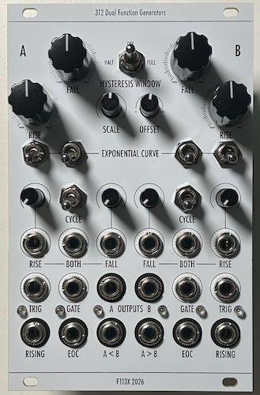

# 312 Dual Function Generators

[TOC]

*Dual Function Generators + Comparator Inspired by Serge DUSG/VCS*

**This modules is almost completely based on Synthfox [SFP34 Slope Generator](https://sfcs.neocities.org/module/SFP34/)& the hysteresis comparator of the [SFP32](https://sfcs.neocities.org/module/SFP32/). Please look at their site as well as I am not the original.**

# v0.1

## Specifications

|Parameter|Value|
|---------|-----|
|Width|16hp|
|Depth|-|
|+12 Current|-|
|-12 Current|-|
|+5 Current|0mA|

## Features

-

## Quirks and Problems

-