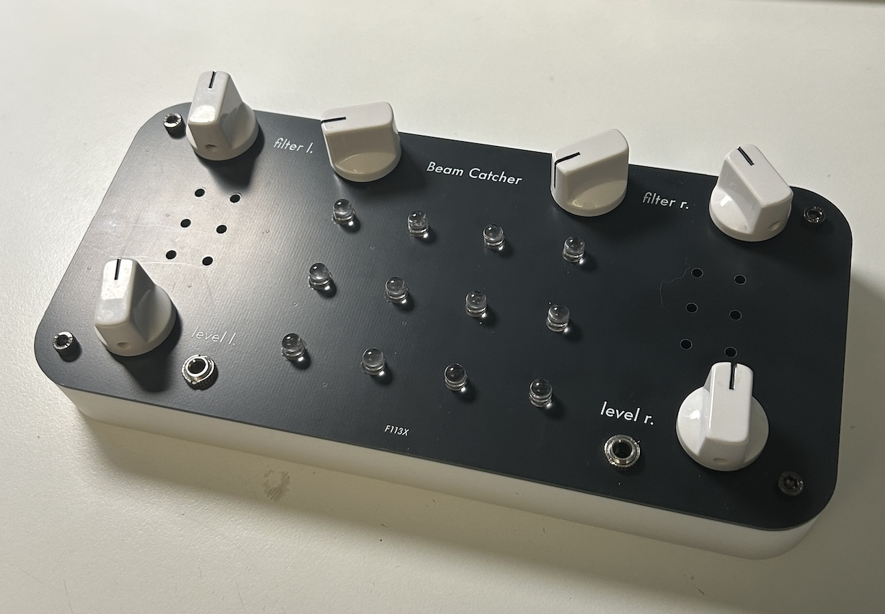

# Beam Catcher

[TOC]

*12-oscillator synth played with light*

# v0.1

The concept and most of this instrument is not my original design. I built this with a few modifications for myself, and this page is meant for documentation. 

Please also check out the [original](https://github.com/uvknhn/Beam-Catcher/) and support the original creator, it's super awesome!

It is a very simple instrument, 12 inverting schmitt-trigger squarewave oscillators (the simplest kinds that is in every beginner diy synth) from 2 CD40106's are driving 12 LEDs to flash at audio rate (each oscillator is tunable), and 2 photodiodes (one for the left channel and one for the right) pick the flashing back up and is amplified through an onboard amplifier, where the volume can be controlled. This also means that the instrument is stereo and "duophonic", and the 2 pickups form a binaural configuration.

That is all from the original design, but when I heard the demo videos I thought the sounds were a bit too harsh at times, which is why I added a lowpass filter to the signal chain of each channel, and in order to animate the sound even more, I came up with a super simple "envelope follower" of sorts, where the amplitude of the incoming audio will *somewhat* control the filter. Those can be controlled via the knobs on the top, where the knob closer to the edge is the cutoff and the other knob controls the "envelope follower" amount. Because this module is powered by 5V from usb and I usually work with ±12V, I did not want to deal with all the differences and opted for a simple vactrol VCF. It's not super accurate but good enough for me. 

This setup makes playing the instrument very expressive and flexible, despite the concept being super simple. The oscillators can be tuned to scales (or non-scales), and hovering the pickups above an LED will yield the frequency of its flashing in the output. Photodiodes are extremily responsive and has much less of the "slewing" effect found in LDRs, so it can pick up higher frequencies as well. The volume that is picked up can be affected by the distance between the pickup and the LED, as well as turning the pickup at different angles. But with the volume attenuation also comes a timbral change, as other sources of interference are introduced when the pickup is away from a single source. Chords are also somewhat possible, when the pickup is brought further from the LEDs, it will often also pick up the frequency of the nearby LEDs, allowing for multiple "notes" to be played at the same time. Note that the results from this will be quite noisy, which can be a good or bad thing.

## Features

- 12 individually tunable squarewave oscillators
- Stereo output with individual volume control
- Stereo lowpass VCF with individual cutoff controls
- Dual envelope follower (one following each channel) which can be used to modulate VCF
- Powered by USB-C (5V)

## Quirks and Problems

- Single-turn trimpots are a PITA to tune
- Filter frequency is quite limited and the "envelope follower" sometimes breaks it, but maybe some electrical tape over the vactrols to reduce light bleed will help